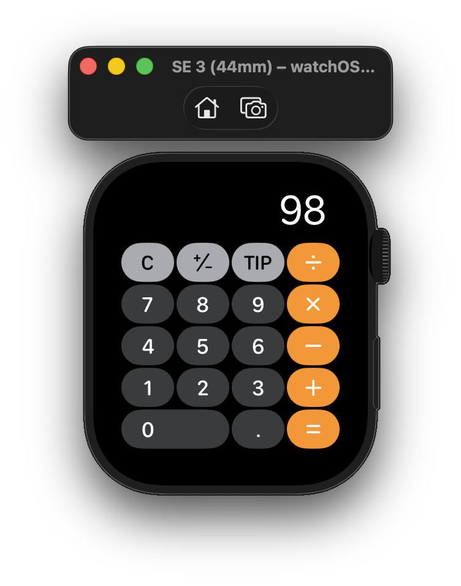
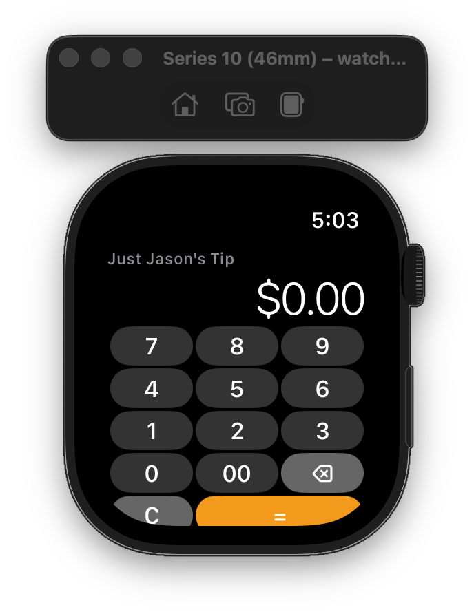

# Tip Calculator

A small tip calculator built two ways: a cross-platform **Expo / React Native** app (iOS, Android, web) and a standalone **watchOS** app written in SwiftUI. Both implementations share the same calculation model — enter a bill, pick a tip percentage, and choose how you want the result rounded.

<p align="center">
  
  
</p>

## Features

- **Bill input** with a numeric keypad and a clear button
- **Tip slider** covering 0–30% (defaults to 20%)
- **Rounding options** applied to either the **tip** or the **total**:
  - `Exact` (no rounding), `Up` (ceiling), `Down` (floor), `Standard` (nearest)
- **Live results** showing the tip amount and the final total
- **Guardrails** on rounding:
  - A 0% tip disables rounding, so a rounded total can never invent a tip
  - The total can never round below the bill (the tip can't go negative)

## Repository layout

```
tip-calculator/
├── App.tsx                     # React Native root component
├── src/                        # React Native app source
│   ├── components/             # BillInput, TipSlider, RoundingPicker, ResultsCard
│   ├── hooks/useTipCalculator.ts   # Core calculation logic
│   ├── utils/rounding.ts       # Rounding helpers
│   ├── types/                  # Shared TypeScript types
│   └── constants/              # Slider limits, rounding options
├── TipCalculatorWatch/         # Standalone watchOS app (SwiftUI)
│   ├── project.yml             # XcodeGen project definition
│   └── TipCalculatorWatch/     # ContentView, TipCalculator, app entry point
├── screens/                    # Reference screenshots
└── DEVELOPMENT_PLAN.md         # Original design notes and phase breakdown
```

## Calculation model

Both apps compute the tip identically. The rounding **target** decides what gets rounded:

- **Round the tip:** round the raw tip, then `total = bill + roundedTip`.
- **Round the total:** round `bill + rawTip`, clamp it to at least `bill`, then derive `tip = total − bill`.

A 0% tip forces the rounding mode to `Exact` in either case. See
[`src/hooks/useTipCalculator.ts`](src/hooks/useTipCalculator.ts) (TypeScript) and
[`TipCalculatorWatch/TipCalculatorWatch/TipCalculator.swift`](TipCalculatorWatch/TipCalculatorWatch/TipCalculator.swift)
(Swift) for the two implementations.

Because the logic lives in two languages, [`TESTCASES.md`](TESTCASES.md) holds a
shared table of worked examples (inputs → expected tip/total) that both
implementations are expected to satisfy.

---

## React Native app (Expo)

**Stack:** Expo `~54`, React Native `0.81`, React `19`, TypeScript. State is plain
`useState` — the app is small enough not to need a state library.

### Prerequisites

- Node.js and npm
- The [Expo Go](https://expo.dev/go) app for on-device testing, or an iOS/Android simulator

### Setup

```bash
npm install
```

### Run

```bash
npm run start     # start the Expo dev server (choose a target from the CLI)
npm run ios       # open in the iOS simulator
npm run android   # open in the Android emulator
npm run web       # run in the browser
```

---

## watchOS app

A standalone watchOS app ("Just Jason's Tip") with a Calculator-style keypad for
entering the bill, the Digital Crown for adjusting the tip percentage, and a
tap-through to rounding settings. The Xcode project is generated from
[`TipCalculatorWatch/project.yml`](TipCalculatorWatch/project.yml) with
[XcodeGen](https://github.com/yonaskolb/XcodeGen).

### Prerequisites

- Xcode with a watchOS SDK (deployment target: watchOS 10.0)
- [XcodeGen](https://github.com/yonaskolb/XcodeGen) (`brew install xcodegen`)

### Build and run

First generate the project (only needed after changing `project.yml`):

```bash
cd TipCalculatorWatch
xcodegen generate
```

**Easiest — Xcode:** open `TipCalculatorWatch.xcodeproj`, pick any Apple Watch
simulator from the scheme dropdown, and hit Run. Xcode boots the simulator,
installs, and launches in one step. When building for a device, set your team
under **Signing & Capabilities** first.

**From the command line:** build, then install onto a *booted* simulator. Note
that `simctl install`/`launch` require the target to be running, so boot one
first and address it with `booted` rather than hard-coding a watch model (device
names change with each Xcode release — run `xcrun simctl list devices available`
to see what you have):

```bash
xcodebuild -project TipCalculatorWatch.xcodeproj -target TipCalculatorWatch \
  -sdk watchsimulator -arch arm64 build

# Boot a watch simulator (pick any available model), then show the Simulator UI
xcrun simctl boot "Apple Watch Series 11 (46mm)"
open -a Simulator

xcrun simctl install booted "build/Debug-watchsimulator/Tip Calculator.app"
xcrun simctl launch booted com.tipcalculator.watchapp
```

---

## Status

Early proof of concept. Both apps implement the full calculation flow; remaining
work (App Store prep, app icon, cross-device watch layout polish, tests) is tracked
in [`DEVELOPMENT_PLAN.md`](DEVELOPMENT_PLAN.md).
